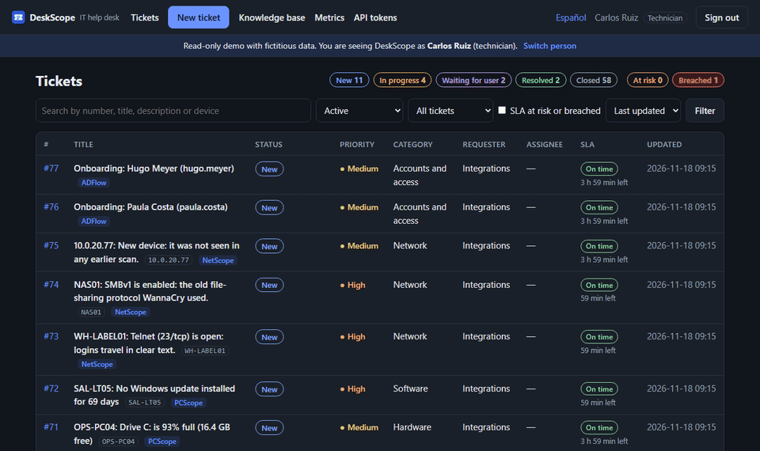

# DeskScope

**Un sistema de tickets de soporte informático para oficinas pequeñas:**
- SLA ITIL en horario laboral;
- base de conocimiento y métricas;
- correo y Telegram;
- tickets que abren solos el inventario y los escaneos de red.

### ▶ [Abrir la demo en vivo](https://davidgori.github.io/DeskScope/)

Es una empresa ficticia con 60 días de historial. Puedes entrar como la administradora, un técnico o una empleada (elige «Español») y ver cómo cambia el mismo servicio de soporte según quién lo mire. *Read in [English](README.md).*



DeskScope es la cuarta pieza de un pequeño kit de sistemas:
- [PCScope](https://github.com/DavidGoRi/PCScope): inventario de PCs;
- [NetScope](https://github.com/DavidGoRi/NetScope): descubrimiento de red;
- [ADFlow](https://github.com/DavidGoRi/ADFlow): altas y bajas en Active Directory.

Reproduce el ciclo de un departamento de soporte real: *el inventario detecta un problema → se abre un ticket → un técnico lo resuelve → la solución queda documentada → las métricas muestran cómo va el servicio*.

## Qué hace

### Tickets
- Roles de empleado, técnico y administrador.
- Flujo `Nuevo → En curso → Esperando al usuario → Resuelto → Cerrado`, con reglas según el rol.
- Notas internas que el empleado no ve, e historial de cada cambio.
- Búsqueda y filtros.
- Interfaz en castellano e inglés, modo claro y oscuro, y uso desde el móvil.

### SLA al estilo ITIL
- **Prioridad:** sale de la matriz impacto × urgencia, a partir de dos preguntas sencillas: *¿a quién afecta?* y *¿puedes seguir trabajando?*
- **Plazos:** primera respuesta y resolución, contados solo en horario laboral, con su zona horaria y festivos.
- **Pausa:** el reloj se para mientras el ticket espera al usuario.
- **Estados:** en plazo, en riesgo, incumplido, en pausa y cumplido.

### Integraciones

| Herramienta | Qué hace en DeskScope |
|---|---|
| **PCScope** | Crea una ficha por equipo, visible dentro de sus tickets, y un ticket por cada aviso crítico. |
| **NetScope** | Abre tickets por hallazgos críticos (Telnet, SMBv1…) y por cada dispositivo nuevo. |
| **ADFlow** | Abre un ticket de alta o de baja por persona, con su lista de tareas. |
| **HardenScope** | Abre un ticket por equipo y comprobación de seguridad fallida (críticas por defecto), con el riesgo, el arreglo y el comando de PowerShell. |

Las importaciones se pueden repetir sin peligro:
- no duplican tickets;
- si cambia el detalle, añaden una nota;
- si el problema desaparece, resuelven el ticket solas;
- lo que necesita a una persona nunca se cierra solo.

### Correo y Telegram
- **Tickets por correo:** un correo de un usuario conocido abre un ticket.
- **Respuestas:** una respuesta a cualquier aviso (el asunto lleva `[DeskScope #12]`) se añade como comentario, sin el texto citado.
- **Correos ignorados:** los de remitentes desconocidos, las respuestas automáticas y los envíos masivos. Así no se forman bucles.
- **Avisos:**
  - los tickets nuevos, al chat de Telegram del equipo;
  - «se te ha asignado», al técnico;
  - las respuestas, «te necesitamos» y «resuelto, valóranos», al empleado;
  - los SLA en riesgo o incumplidos, a Telegram y al técnico.
- **Bandeja de salida:**
  - ninguna página espera al servidor de correo;
  - si falla, se reintenta;
  - nadie recibe el mismo aviso dos veces.
- **Contraseñas:** solo en variables de entorno.

### Base de conocimiento y métricas
- **Artículos:** se crean a partir de tickets resueltos y se sugieren mientras el empleado escribe su ticket.
- **Búsqueda:** de texto completo y sin distinguir tildes.
- **Encuesta de satisfacción:** del 1 al 5.
- **Métricas de 7, 30 o 90 días**, en horario laboral:
  - tiempo medio y mediana de resolución;
  - primera respuesta;
  - % en plazo y satisfacción;
  - un gráfico diario y desgloses.
- **Exportación a CSV:** protegida contra la inyección de fórmulas.

### API REST y seguridad
- **API en `/api/v1`:**
  - tokens que se muestran una sola vez y se guardan como hash;
  - solo acepta la cabecera `Authorization`, nunca la cookie de sesión, así que no tiene riesgo de CSRF;
  - usa los mismos permisos que la web.
- **Seguridad:**
  - contraseñas con PBKDF2 (600 000 iteraciones) y token CSRF en cada formulario;
  - bloqueo tras 5 intentos fallidos y CSP estricta;
  - un ticket ajeno da 404 y no 403;
  - el contenedor de Docker no se ejecuta como root.

## Probarlo

```bash
pip install -e .
deskscope demo --lang es        # empresa ficticia con historial, artículos e importaciones
deskscope serve                 # http://127.0.0.1:8000
```

Todas las cuentas de la demo tienen la contraseña `deskscope-demo`:
- `carlos.ruiz` (técnico);
- `laura.sanchez` (administradora);
- `ana.garcia` (empleada).

Con Docker:

```bash
docker compose up -d
```

En el [README en inglés](README.md) tienes la configuración completa (`sla.json`, `notifications.json`), la lista de comandos y el ejemplo de PowerShell que envía los datos de PCScope a la API.

## Desarrollo

Hay 252 tests en Windows y Linux, con Python 3.10 y 3.13. El CI además:
- arranca el servidor;
- llama a la API con un token real;
- construye la imagen de Docker y la ejecuta.

La demo en vivo la genera la propia aplicación (`tools/build_demo.py`) y se regenera cada semana.

Licencia [MIT](LICENSE). Todos los nombres de la demo son ficticios.
