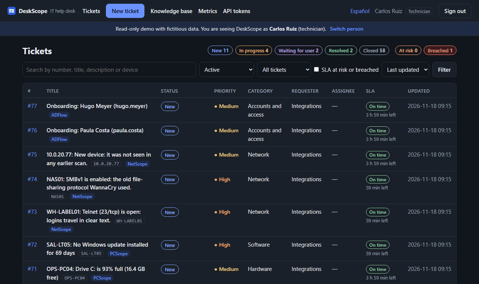

# DeskScope

[](https://github.com/DavidGoRi/DeskScope/actions/workflows/ci.yml)
[](https://davidgori.github.io/DeskScope/)
[](https://github.com/DavidGoRi/DeskScope/releases/latest)


**A lightweight IT help desk for small offices: tickets with ITIL SLAs in business hours, a knowledge base, metrics, email and Telegram, and tickets opened automatically by your inventory and network scans.**

### ▶ [Open the live demo](https://davidgori.github.io/DeskScope/)

A fictitious company with 60 days of history. Sign in as the administrator, a technician or an employee and see how the same desk changes. *Leer en [español](README.es.md).*



DeskScope is the fourth piece of a small sysadmin toolkit:

| Project | What it does |
|---|---|
| [PCScope](https://github.com/DavidGoRi/PCScope) | Inventory and health of Windows PCs |
| [NetScope](https://github.com/DavidGoRi/NetScope) | Finds and identifies every device on the LAN |
| [ADFlow](https://github.com/DavidGoRi/ADFlow) | Automated Active Directory onboarding and offboarding |
| [HardenScope](https://github.com/DavidGoRi/HardenScope) | Read-only security hardening audit of Windows computers |
| **DeskScope** | The help desk where all of that becomes tickets |

The goal is the loop a real service desk lives in: *the inventory spots a problem → a ticket is opened → a technician fixes it → the fix is documented → the numbers show how the desk is doing*.

## Features

### Tickets

- Category, impact, urgency, priority, device, status and a conversation, with **internal notes** the employee never sees.
- **Three roles**: employees open and follow *their own* tickets; technicians see and work every ticket; administrators also manage accounts.
- **Workflow** `New → In progress → Waiting for user → Resolved → Closed`, with rules per role: an employee can confirm or reject a fix, a closed ticket stays closed, and a reply from the employee puts a waiting ticket back in the queue.
- **Audit trail** of every change (status, assignee, impact, urgency, priority, rating) with who and when.
- **Search and filters** by number, text, device, status, "assigned to me", "unassigned", SLA risk and due date.
- **English and Spanish** interface (browser language or a switch), light and dark mode, usable on a phone.

### SLAs the ITIL way

- **Priority is not a free choice.** The employee answers two plain questions, *who is affected?* (impact) and *can you keep working?* (urgency), and the priority comes from the ITIL matrix, previewed live while typing. Technicians re-triage.

  | Impact ↓ / Urgency → | High | Medium | Low |
  |---|---|---|---|
  | **High** (office or site) | Critical | High | Medium |
  | **Medium** (team) | High | Medium | Low |
  | **Low** (one person) | Medium | Low | Low |

- **Two clocks per ticket**: *first response* (the first public answer from the desk, or the fix) and *resolution*.
- **Business hours only**: working days, opening hours, time zone and holidays from `sla.json`; a ticket opened on Friday at 17:30 is not late on Saturday.
- **Paused while waiting for the user**, as ITIL expects.
- **States**: on time, at risk (75 % of the target used, configurable), breached, paused, met — in the list, as counters, as a filter and as progress bars on each ticket.

| Priority | First response | Resolution |
|---|---|---|
| Critical | 30 min | 4 h |
| High | 1 h | 8 h |
| Medium | 4 h | 3 days |
| Low | 8 h | 5 days |

(Default targets in business time, all editable.)

### Integrations: the toolkit opens its own tickets

| From | What it reads | What happens in DeskScope |
|---|---|---|
| **PCScope** | `devices.csv` + `issues.csv` from `PCScope.ps1 -ExportCsv` | A **device sheet** per computer (model, serial, Windows build, disk, BitLocker, antivirus, last user…) shown inside every ticket about that device, with its other tickets. One ticket per device and rule for critical issues (or the levels you choose). |
| **NetScope** | a `scan-*.json` (or the newest in its folder) | Tickets for critical findings (Telnet open, SMBv1…) and for **devices seen for the first time**. |
| **ADFlow** | the `summary.json` of a live run | An **onboarding** ticket per account created (groups, mailbox, home folder and a checklist) and an **offboarding** ticket per account disabled. |
| **HardenScope** | a fleet report (`fleet-*.json`), or sent by `HardenScope.ps1 -DeskScopeUrl` | One ticket per computer and **failed security check** (critical by default, `--severities critical,high`) with the risk, the fix and the PowerShell command. Fixed checks are resolved by the next audit; computers that could not be reached keep their tickets. |

Imports are **idempotent and self-healing**:

- each finding has a stable key (`pcscope:OPS-PC04:diskSpace`) and the database refuses two *active* tickets with the same key (partial unique index), so re-running an import never duplicates anything;
- if the details change (*93 % full → 97 % full*) an internal note is added instead of a new ticket;
- when a later import no longer reports a problem on a device it inventoried, the ticket is **resolved automatically**; a problem that comes back opens a new ticket, so the history stays honest;
- events that need a person (a new device on the network, an onboarding) are never closed automatically.

Tickets from tools are opened by a built-in `integrations` system account that can never sign in.

```bash
deskscope import pcscope  \\fileserver\pcscope\export --lang es
deskscope import netscope C:\NetScope\output
deskscope import adflow   C:\ADFlow\output\runs\20261117-080000-onboarding
deskscope import hardenscope C:\HardenScope\output --severities critical,high
```

### Email and Telegram

- **Tickets by email**: a message from a known user opens a ticket; a reply to any notification (its subject carries `[DeskScope #12]`) becomes a comment on that ticket, with the quoted text removed. Unknown senders, auto-replies and bulk mail are ignored (no mail loops), and every `Message-ID` is remembered so nothing is imported twice.
- **Notifications**: new tickets to the desk's Telegram chat; *assigned to you* to the technician; answers, *waiting for you* and *resolved (rate us)* to the employee; employee replies to the technician; *SLA at risk / breached* to Telegram and the technician — once per ticket, clock and state.
- Built on an **outbox**: the notifier reads the audit trail since its last run, queues messages with a unique key and sends them with retries. Web requests never wait for SMTP, an outage loses nothing and nobody gets the same message twice.
- Settings in `notifications.json` ([example](notifications.example.json)); passwords only in environment variables (`DESKSCOPE_SMTP_PASSWORD`, `DESKSCOPE_TELEGRAM_TOKEN`, `DESKSCOPE_IMAP_PASSWORD`).

### Knowledge base and self-service

- **Articles written from solved tickets**: one click pre-fills the problem and the desk's public answers (never the internal notes) and links them.
- **Self-service before the ticket**: while an employee types the summary of a new ticket, matching articles appear under it.
- **Full-text search** with SQLite FTS5: BM25 ranking, prefixes, accent-insensitive (*impresion* finds *impresión*); free text is turned into quoted terms, so nobody can inject FTS operators.
- Articles for everyone or for the service desk only (internal procedures), drafts, read counters, and **related articles** on every ticket for technicians.

### Metrics, satisfaction and export

- **Satisfaction survey** (1–5 and a comment) once a ticket is resolved.
- **Metrics** for the last 7, 30 or 90 days: volumes and backlog at risk; mean and median **time to resolve** and **first response** in business time, measured by the SLA engine; **% on time**; **satisfaction**; a daily chart (server-rendered SVG, no JavaScript library); breakdowns by priority, category, technician, source and device.
- **CSV export** with business durations and SLA states, UTF-8 with BOM for Excel and protected against **CSV/formula injection** (ticket titles are typed by users).

### REST API

Everything is also available at `/api/v1` (OpenAPI at `/api/openapi.json`, Swagger UI at `/api/docs`) with **bearer tokens** each person creates under *API tokens*: 256-bit secrets shown once and stored as SHA-256, revocable, with their last use. The API only accepts the `Authorization` header — never the session cookie — so it is not exposed to CSRF, and it goes through the same domain functions as the pages, with the token owner's permissions.

PCScope's scheduled task can push its results straight to DeskScope (tested with Windows PowerShell 5.1):

```powershell
$headers = @{ Authorization = "Bearer $env:DESKSCOPE_TOKEN" }
$body = @{
    devices = @(Import-Csv .\output\export\devices.csv -Delimiter ';')
    issues  = @(Import-Csv .\output\export\issues.csv -Delimiter ';')
} | ConvertTo-Json -Depth 4
Invoke-RestMethod -Method Post -Uri 'https://deskscope.example.com/api/v1/import/pcscope' `
    -Headers $headers -ContentType 'application/json; charset=utf-8' `
    -Body ([Text.Encoding]::UTF8.GetBytes($body))
```

(`deskscope token create integrations --name "PCScope task"` prints a token for the system account.)

### Security, because a help desk holds sensitive data

- Passwords hashed with **PBKDF2-SHA256, 600,000 rounds** (standard library).
- **CSRF token** on every form, `SameSite=Lax` and `HttpOnly` session cookies, a new session on every login.
- **Brute-force throttling**: 5 failed logins in 15 minutes lock that user from that address.
- Strict **Content-Security-Policy** (no inline scripts or styles), `X-Frame-Options: DENY`, `nosniff`, `no-store`.
- Tickets you may not see answer **404, not 403**, so ticket numbers cannot be probed.
- Permissions are enforced in the domain layer, so the web pages, the API, the importers and the mail gateway all share them.
- No open redirects, escaped output, hashed API tokens, formula-safe CSV, secrets only in environment variables, and a non-root Docker container.

## Try it

```bash
git clone https://github.com/DavidGoRi/DeskScope.git
cd DeskScope
python -m venv .venv
.venv\Scripts\activate          # Linux/macOS: source .venv/bin/activate
pip install -e .

deskscope demo --lang en        # fictitious company: 60 days of history, articles, imports
deskscope serve                 # http://127.0.0.1:8000
```

Every demo account uses the password `deskscope-demo`: `carlos.ruiz` (technician), `laura.sanchez` (administrator) or `ana.garcia` (employee).

### With Docker

```bash
docker compose up -d            # http://localhost:8000, data in the deskscope-data volume
docker compose exec -e DESKSCOPE_PASSWORD='choose-one' deskscope \
  deskscope create-user laura --name "Laura Sánchez" --email laura@example.com --role admin
```

The image runs as a non-root user, has a health check and runs the mail/notification worker in the same process (`--worker-every 60`).

### Real use

```bash
deskscope init
deskscope create-user laura --name "Laura Sánchez" --email laura@example.com --role admin
deskscope serve --host 0.0.0.0 --secure-cookies --worker-every 60   # behind an HTTPS reverse proxy
```

| Setting | Default |
|---|---|
| `--db` / `DESKSCOPE_DB` | `data/deskscope.db` |
| `DESKSCOPE_SECRET_KEY` | generated once in `data/secret.key` |
| `--sla` / `DESKSCOPE_SLA` | `sla.json` next to the database, else built-in defaults ([example](sla.example.json) with Madrid hours and Spanish holidays) |
| `--notify-config` / `DESKSCOPE_NOTIFY` | `notifications.json` next to the database, else everything off ([example](notifications.example.json)) |

`deskscope sla` validates the SLA file, `deskscope notify --dry-run` shows what would be sent, and `deskscope worker` runs mail and notifications on their own (e.g. as a service) instead of inside `serve`.

| Command | |
|---|---|
| `init`, `create-user`, `token create/list/revoke` | database, accounts, API tokens |
| `demo [--lang es] [--history 60]` | fictitious company |
| `import pcscope / netscope / adflow / hardenscope` | tickets from the toolkit |
| `notify`, `fetch-mail`, `worker --every 60` | email and Telegram |
| `sla`, `serve` | policy check, web server |

## Development

```bash
pip install -e ".[dev]"
ruff check .
python -m pytest
python tools/build_demo.py _site                  # the static live demo
powershell -File tools/Update-Screenshots.ps1     # docs/*.png and docs/demo.gif
```

252 tests (domain rules and permissions, the business-hours calendar and SLA clocks, schema migrations including a table rebuild, the three importers, tokens and the REST API, full-text search, metrics on a fixed calendar, CSV injection, notifications and the outbox, mail parsing, web flows, security headers, translations, demo data and CLI) run on Windows and Linux with Python 3.10 and 3.13. CI also starts the real server and calls the API with a real token, and builds and runs the Docker image.

- The schema evolves through numbered SQL migrations (`src/deskscope/migrations/`), each in one transaction, with the foreign-key procedure SQLite requires for table rebuilds; a v0.1 database upgrades to v1.0 without losing anything.
- The live demo is rendered by the real application (`tools/build_demo.py` signs in as each person and crawls the pages) and rebuilt every week by GitHub Actions, so its dates and SLA clocks stay current.
- The fictitious exports used by the demo and the tests are in [`src/deskscope/examples`](src/deskscope/examples).

```
src/deskscope/
  models.py        vocabulary, workflow rules, errors
  tickets.py       ticket rules (every function takes the acting user)
  sla.py           business calendar, SLA clocks, sla.json
  integrations.py  PCScope / NetScope / ADFlow importers and reconciliation
  knowledge.py     knowledge base and FTS5 search
  reports.py       metrics and CSV export
  notify.py        outbox, email and Telegram notifications
  mailin.py        tickets and replies by email (IMAP)
  tokens.py        API tokens (hashed)
  api.py           REST API mounted at /api
  web.py           FastAPI pages, sessions, CSRF, security headers
  users.py         accounts and authentication
  security.py      password hashing, tokens
  i18n.py          English and Spanish text
  seed.py          fictitious demo company
  cli.py           command line
  migrations/      numbered SQL schema migrations
```

## License

[MIT](LICENSE). All names in the demo are fictitious and use `example.com`.
